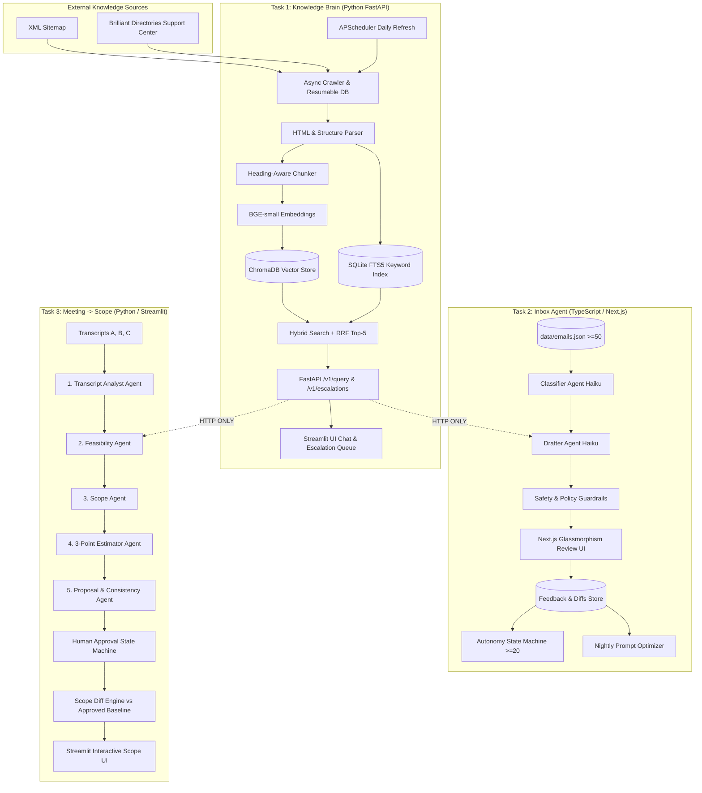

# DESIGN.md — AI Tech Consultant Architecture & System Design

## 1. System Vision & Architecture

The AI Tech Consultant is an end-to-end multi-agent system designed for software consultancies and SaaS platforms (specifically tailored to the Brilliant Directories ecosystem). It connects technical documentation, client communication triaging, and project scoping into a coherent pipeline with human approval gates.

### Architecture Diagram

---

## 2. Hard Isolation Rules

1. **HTTP Only Coupling**: Task 2 (TypeScript) and Task 3 (Python) never import or share code with Task 1. All knowledge queries occur over the versioned `/v1/query` REST API authenticated with `X-API-Key`.
2. **Language Boundaries**: No multi-language mixing inside a single task. Task 1 is pure Python, Task 2 is pure TypeScript/Node, and Task 3 is pure Python.
3. **Deterministic Mocking**: All tasks support offline local operation and fast deterministic tests via thin `LLMClient` wrappers, ensuring continuous integration without external API dependencies.
4. **Human in the Loop**: No client email or project scope proposal ever leaves the system without explicit human review and approval.

---

## 3. Component Deep Dive

### 3.1 Task 1: Knowledge Brain
- **Resumable Ingestion**: SQLite `pages` table tracks `(url, lastmod, content_hash, status, attempts, last_error, fetched_at, active)`. If the crawler is terminated midway, it resumes without re-crawling completed pages.
- **Hybrid Retrieval & RRF**: Combines dense vector cosine similarity (ChromaDB) with sparse BM25 keyword matching (SQLite FTS5) via Reciprocal Rank Fusion:
  $$\text{RRF Score} = \sum \frac{1}{60 + \text{rank}}$$
- **Grounded Evidence Guard**: The answer service treats all retrieved chunks as untrusted data. If evidence does not directly support the claim, it outputs `insufficient_evidence` and creates an escalation record in SQLite.
- **Daily Freshness**: APScheduler queries the sitemap daily. Removed pages have their vectors deleted and status set to `active=0`. Removed articles never appear in answers.

### 3.2 Task 2: Inbox Agent
- **Classification Taxonomy**: Fixed 8-category enum (`how_to`, `troubleshooting`, `project_request`, `refund_cancellation`, `complaint`, `quote`, `follow_up`, `other`).
- **Safety Policy Guardrails**:
  - `refund_cancellation`, `quote`, and `complaint` strictly mandate human review (`needs_human=true`).
  - Unauthorized promises of refunds, fixed prices, or guaranteed launch dates are blocked by regex & schema validators.
  - If T1 is unreachable, draft state transitions to `knowledge_unavailable` without hallucinating facts.
- **Earned Autonomy Algorithm**:
  - A subcategory counter tracks consecutive unchanged drafts approved by human operators.
  - At 20 consecutive approvals, the subcategory becomes "eligible" (not automatically enabled).
  - Auto-send requires low risk, verified sources, and explicit human activation.
  - A rolling quality monitor auto-disables autonomy if edit rates breach 25%.
- **Prompt Evolution**:
  - Normalized diff similarity metric:
    $$\text{Similarity} = 0.7 \cdot \text{Jaccard} + 0.3 \cdot \text{LengthRatio}$$
  - Nightly optimizer clusters edit reasons per subcategory and proposes versioned prompt upgrades (e.g., `drafting@v2`).

### 3.3 Task 3: Meeting-to-Scope
- **5-Agent Workflow**:
  1. *Analyst*: Chunks transcripts with overlap and extracts requirements with timestamps and direct source quotes.
  2. *Feasibility*: Queries T1 over HTTP to determine if requirements are native configuration (`existing_config`) or custom development (`custom_dev`).
  3. *Scope*: Constructs SOW with deliverables, exclusions, assumptions, acceptance criteria, and client responsibilities.
  4. *Estimator*: 3-point task estimates (low, likely, high). Totals summed deterministically by Python.
  5. *Proposal & Consistency*: Checks exclusions and verifies no unsupported claims are promised.
- **Diff Engine Against Approved Baseline**:
  - When reviewing follow-up meetings (Transcript C), diffs are computed exclusively against the *approved baseline* (Transcript A), never an unapproved draft.
  - Detects additions (e.g. Geolocation search), removals (e.g. Fax lookup), and flags out-of-scope requests (e.g. Native iOS/Android apps).
- **Approval State Machine**:
  `draft -> in_review -> approved -> sent`. Bypassing approval throws a hard security exception.

---

## 4. Dropped Features (Explicitly Out of Scope per §11)

In adherence to Section 11 of the specification, the following capabilities were deliberately omitted from v1:
1. **Real Email SMTP / IMAP Delivery**: Real email transmission was simulated and logged to avoid outbound spam and domain reputation hazards.
2. **Multi-Tenant User Authentication**: Single-tenant team model was implemented; multi-tenant enterprise RBAC was deferred.
3. **Knowledge Graph Visualizers**: Simple hierarchical taxonomy and vector/FTS indices were used instead of Neo4j/Graph databases.
4. **Custom Model Fine-Tuning**: Off-the-shelf Claude Haiku and Gemini Flash with few-shot in-context learning were chosen over proprietary model weights.
5. **Over-Engineered Analytics Dashboards**: Replaced with clean, focused Streamlit and Next.js interfaces directly aligned with core operator tasks.
